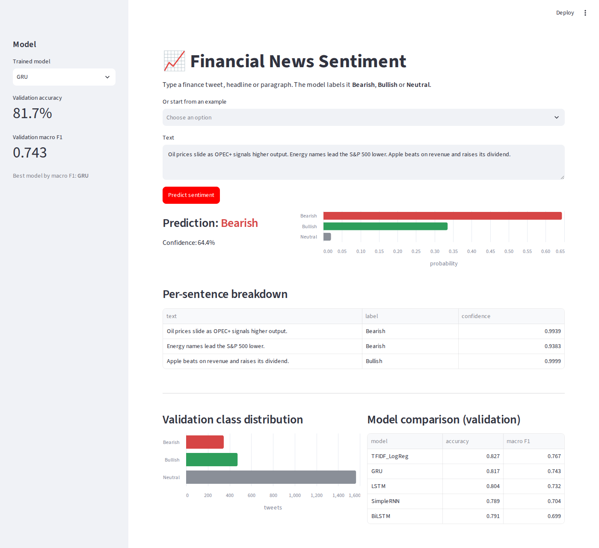

# Financial News Sentiment Prediction using Deep Learning & BERT

Classify finance tweets and headlines as **Bearish**, **Bullish** or **Neutral**.
Four recurrent models are built from scratch in PyTorch (Embedding + SimpleRNN,
LSTM, GRU, BiLSTM), a BERT/FinBERT fine-tuning pipeline runs on the same data,
and a Streamlit dashboard plus a command-line script turn raw text into a
sentiment label.

**Dataset:** [`zeroshot/twitter-financial-news-sentiment`](https://huggingface.co/datasets/zeroshot/twitter-financial-news-sentiment),
official splits only: 9,543 train / 2,388 validation tweets
(labels: 0 Bearish, 1 Bullish, 2 Neutral; about 65% Neutral).

## Results (validation split)

| Model | Params | Accuracy | Macro F1 | Bearish F1 | Bullish F1 | Neutral F1 |
|---|---:|---:|---:|---:|---:|---:|
| **GRU** (best RNN) | 1.02M | **0.817** | **0.743** | 0.621 | 0.722 | 0.886 |
| LSTM | 1.05M | 0.804 | 0.732 | 0.600 | 0.715 | 0.881 |
| SimpleRNN | 0.95M | 0.789 | 0.704 | 0.586 | 0.651 | 0.874 |
| BiLSTM | 1.18M | 0.791 | 0.699 | 0.563 | 0.658 | 0.878 |
| TF-IDF + LogReg (reference) | - | 0.827 | 0.767 | 0.679 | 0.733 | 0.889 |
| BERT (fine-tuned) | 110M | *run `python -m src.bert_finetune`* | | | | |

* **Gated cells win.** GRU and LSTM keep an early sentiment word ("downgrade",
  "beats") from being overwritten by the tickers, source tags and URLs that
  follow it. GRU matches LSTM with fewer parameters, which suits ~8.6k training
  tweets. The BiLSTM's extra capacity mostly memorises.
* **Errors are missed sentiment, not flipped polarity:** 29% of Bearish and 21%
  of Bullish tweets are predicted Neutral (implicit sentiment, domain-specific
  phrasing, hedged quotes, borderline labels).
* **Why BERT:** a from-scratch RNN cannot learn rare finance vocabulary from
  9.5k tweets (13% of validation tokens are unknown), so even TF-IDF beats it.
  Pre-trained BERT brings that knowledge in. Its numbers are added to the
  PDF report and charts automatically after training (see below).

Full write-up with charts and error analysis: [`reports/comparison_report.pdf`](reports/comparison_report.pdf) (2 pages).

> **BERT status.** The fine-tuning code is complete and was verified end to end
> with a tiny offline model (`--smoke-test`), but the pre-trained weights could
> not be downloaded in the environment where this repo was built (no Hugging
> Face access, CPU only). Run section 6 of the notebook on Google Colab (GPU
> runtime, roughly 10 minutes) or `python -m src.bert_finetune` on any machine
> with internet access, then `python scripts/make_report.py`.

## Project structure

```
sentiment-project/
├── data/raw/                 sent_train.csv, sent_valid.csv (official splits)
├── src/
│   ├── config.py             paths, labels, hyperparameters
│   ├── data.py               loading, cleaning, tokeniser, vocabulary, datasets
│   ├── models.py             RNNClassifier (RNN / LSTM / GRU, optional bidirectional)
│   ├── train.py              training loop, early stopping, save/load
│   ├── evaluate.py           metrics, confusion matrices, error analysis
│   ├── run_baselines.py      trains + evaluates all baselines
│   ├── bert_finetune.py      BERT / FinBERT fine-tuning
│   └── predict.py            raw paragraph -> sentiment (CLI + Python API)
├── app/streamlit_app.py      dashboard
├── notebooks/financial_sentiment.ipynb   documented end-to-end walk-through (executed)
├── scripts/
│   ├── make_report.py        figures + 2-page PDF from saved metrics
│   └── build_notebook.py     regenerates the notebook from source
├── models/                   trained baselines (state dict + vocab + config)
└── reports/                  comparison_report.pdf, figures/, metrics/*.json
```

## Setup

```bash
python -m venv .venv && source .venv/bin/activate     # Windows: .venv\Scripts\activate
pip install -r requirements.txt
```

Python 3.10+; a GPU is only needed for BERT.

## Run the pipeline

All commands run from the project root.

```bash
# 1. Train and evaluate the RNN baselines (CPU, about 3 minutes)
python -m src.run_baselines

# 2. Fine-tune BERT (GPU recommended); FinBERT is a drop-in alternative
python -m src.bert_finetune
python -m src.bert_finetune --model-name ProsusAI/finbert --run-name BERT

# 3. Rebuild the comparison figures and PDF report
python scripts/make_report.py

# 4. Score any text (uses the best model by validation macro F1)
python -m src.predict "Oil prices slide as OPEC+ signals higher output. Apple beats on revenue."
python -m src.predict --file article.txt --model LSTM --json

# 5. Launch the dashboard
streamlit run app/streamlit_app.py
```

Or open `notebooks/financial_sentiment.ipynb` and run all cells. On Colab:
upload the project folder, `%cd sentiment-project`, `!pip install -r requirements.txt`,
switch to a GPU runtime, and section 6 fine-tunes BERT automatically.

### Example

```
$ python -m src.predict "Oil prices slide as OPEC+ signals higher output. Energy names lead the S&P 500 lower. Apple beats on revenue and raises its dividend."
Model:     GRU
Sentiment: BEARISH   (Bearish 64.4%  Bullish 33.6%  Neutral 2.1%)
Per sentence:
  [Bearish 99%] Oil prices slide as OPEC+ signals higher output.
  [Bearish 94%] Energy names lead the S&P 500 lower.
  [Bullish 100%] Apple beats on revenue and raises its dividend.
```

## Streamlit dashboard



Pick a trained model in the sidebar (its validation accuracy and macro F1 are
shown), type a tweet, headline or paragraph, and get the predicted label, a
class-probability bar chart and a per-sentence breakdown. Below are the
validation class distribution and the model leaderboard.

## Method

**Preprocessing.** URLs and @mentions are removed, `&amp;` is unescaped, text is
lower-cased; **$tickers, numbers and percentages are kept** as single tokens.
The vocabulary (min frequency 2, 7,162 tokens) is built from training tweets only.

**No leakage.** A stratified 10% *dev* slice of TRAIN drives early stopping
and learning-rate decay. The official validation split is used only for the
reported numbers.

**RNN architecture.** Embedding(128) → RNN/LSTM/GRU (128 units, packed sequences)
→ [final hidden state ; masked max-pool] → Dropout(0.4) → Linear(3).
Adam lr 2e-3 (halved on plateau), class-weighted cross-entropy for the 65%
Neutral imbalance, gradient clipping 1.0, early stopping on dev macro F1
(patience 4) with the best epoch restored. Seed 42; reruns reproduce the table.

**BERT.** `bert-base-uncased` (or `ProsusAI/finbert`) with a new 3-way head,
max length 64, batch 32, AdamW lr 2e-5, weight decay 0.01, linear warm-up/decay,
class-weighted loss, early stopping on dev macro F1 (patience 2, up to 4 epochs).

**Inference.** `src/predict.py` splits a paragraph into sentences, scores each,
and averages the probabilities, so one bearish sentence in a neutral paragraph
still shows up.

## Code quality

PEP 8 checked with `flake8` (config in `setup.cfg`). Data loading, preprocessing,
training, evaluation and inference are separate modules; the notebook and the
scripts call the same functions.
